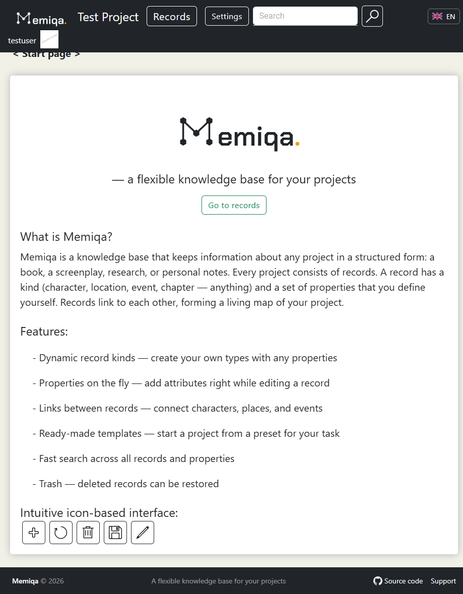
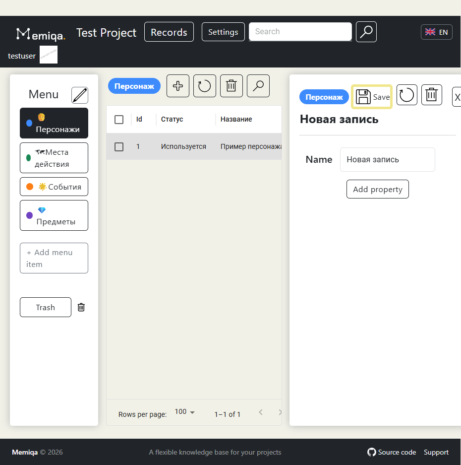
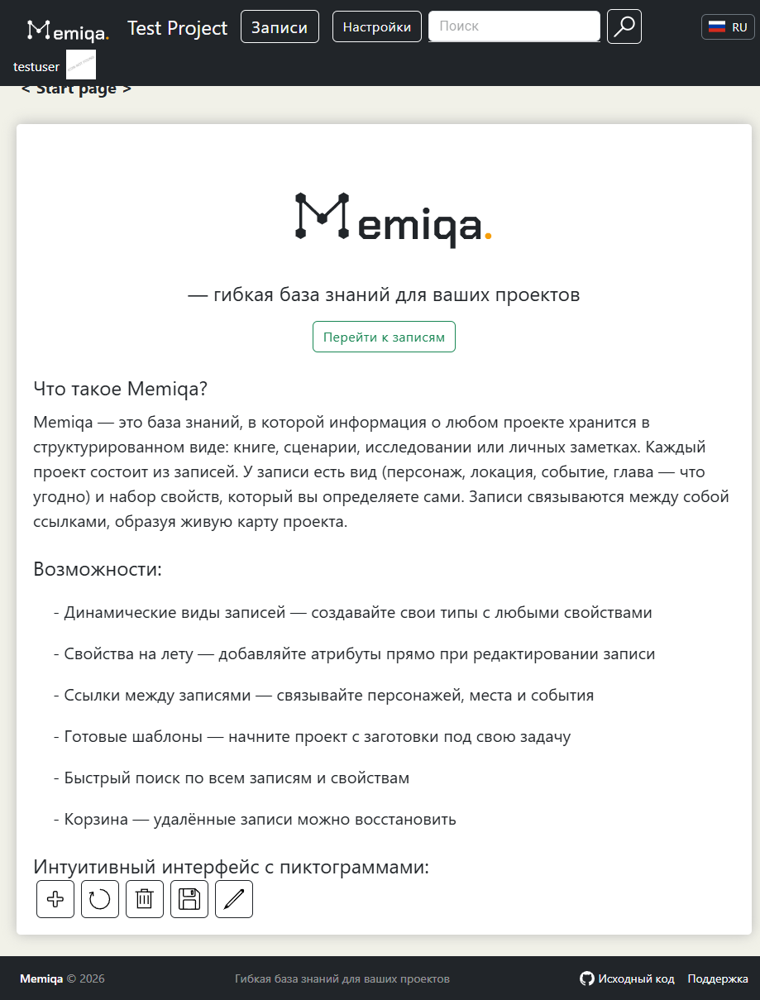
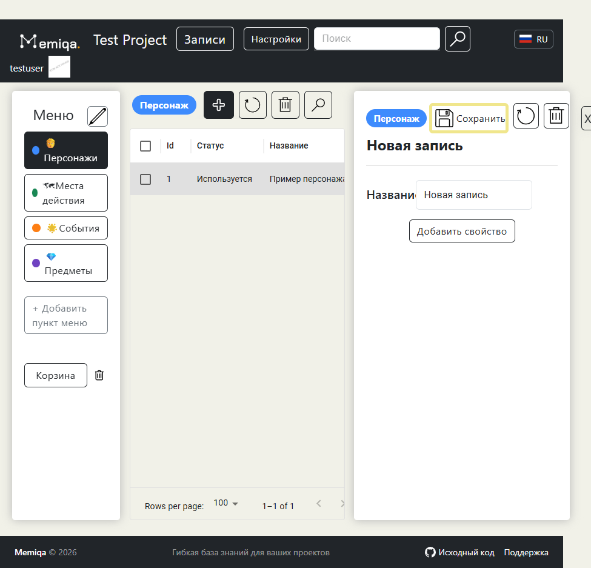

# Memiqa

[Русская версия ниже](#memiqa--русская-версия)

**Memiqa** is a personal knowledge base for writers and worldbuilders. It helps you keep everything about your fictional world — characters, locations, events, artifacts, and ideas — in one organized, searchable place.

This repository contains the official desktop app releases. Download the latest version from the [Releases page](https://github.com/dimitriy-tolstikov/Memiqa-releases/releases/latest).

## What you can do with Memiqa

- **Create your own object types.** Characters, cities, guilds, magic systems — define the kinds of things your world consists of, with custom attributes and colors for each type.
- **Fill your world with records.** Every record gets a rich description, images, and links to related records.
- **Find anything instantly.** Full-text search with filters by type and attributes.
- **Start quickly with templates.** New projects can be pre-filled with ready-made structures, so you can start writing instead of configuring.
- **Keep favorites at hand.** Pin important records to the menu for one-click access.
- **Never lose context.** Change history lets you look back at how a record evolved.
- **Work in your language.** The interface is available in English and Russian.
- **Stay offline.** The desktop app stores all your data locally on your machine — no account on someone else's server, no internet required.

## Download and install

Get the installer for your platform from the [latest release](https://github.com/dimitriy-tolstikov/Memiqa-releases/releases/latest):

| Platform | File |
|---|---|
| Windows | `Memiqa_*_x64-setup.exe` (recommended) or `Memiqa_*_x64_en-US.msi` |
| Linux (Debian/Ubuntu) | `Memiqa_*_amd64.deb` |
| Linux (Fedora/RHEL) | `Memiqa-*-1.x86_64.rpm` |
| Linux (any) | `Memiqa_*_amd64.AppImage` — make it executable and run |

### Windows notes

The installer is not signed with a commercial certificate, so Windows SmartScreen may show a warning on first launch. Click **"More info" → "Run anyway"** — this is expected for independent releases.

### Linux notes

- `.deb`: `sudo apt install ./Memiqa_*_amd64.deb`
- `.rpm`: `sudo dnf install ./Memiqa-*-1.x86_64.rpm`
- `.AppImage`: `chmod +x Memiqa_*_amd64.AppImage && ./Memiqa_*_amd64.AppImage`

## Automatic updates

The app checks for updates on startup. When a new version is released, Memiqa will offer to download and install it automatically — no need to revisit this page.

## Data and privacy

- All your data stays on your computer in the standard application data folder.
- Closing the window minimizes Memiqa to the system tray; use the tray menu to quit completely.

## Feedback

Found a bug or have an idea? Open an [issue](https://github.com/dimitriy-tolstikov/Memiqa-releases/issues).

---

# Memiqa — русская версия

**Memiqa** — это персональная база знаний для писателей и авторов вымышленных миров. Она помогает держать всё о вашем мире — персонажей, локации, события, артефакты и идеи — в одном упорядоченном месте с быстрым поиском.

В этом репозитории публикуются официальные сборки десктопного приложения. Скачать последнюю версию можно на [странице релизов](https://github.com/dimitriy-tolstikov/Memiqa-releases/releases/latest).

## Возможности Memiqa

- **Свои типы объектов.** Персонажи, города, гильдии, магические системы — определяйте виды сущностей вашего мира с собственными атрибутами и цветами.
- **Записи о всём.** У каждой записи — подробное описание, изображения и связи с другими записями.
- **Мгновенный поиск.** Полнотекстовый поиск с фильтрами по типам и атрибутам.
- **Быстрый старт с шаблонами.** Новый проект можно сразу наполнить готовой структурой и начать писать, а не настраивать.
- **Избранное под рукой.** Закрепляйте важные записи в меню для доступа в один клик.
- **История изменений.** Всегда можно посмотреть, как менялась запись.
- **Интерфейс на русском и английском.**
- **Работа офлайн.** Десктопное приложение хранит все данные локально на вашем компьютере — без аккаунта на чужом сервере и без интернета.

## Скачать и установить

Выберите установщик для вашей платформы в [последнем релизе](https://github.com/dimitriy-tolstikov/Memiqa-releases/releases/latest):

| Платформа | Файл |
|---|---|
| Windows | `Memiqa_*_x64-setup.exe` (рекомендуется) или `Memiqa_*_x64_en-US.msi` |
| Linux (Debian/Ubuntu) | `Memiqa_*_amd64.deb` |
| Linux (Fedora/RHEL) | `Memiqa-*-1.x86_64.rpm` |
| Linux (любой) | `Memiqa_*_amd64.AppImage` — сделайте исполняемым и запустите |

### Примечание для Windows

Установщик не подписан коммерческим сертификатом, поэтому при первом запуске Windows SmartScreen может показать предупреждение. Нажмите **«Подробнее» → «Выполнить в любом случае»** — это ожидаемо для независимых релизов.

### Примечание для Linux

- `.deb`: `sudo apt install ./Memiqa_*_amd64.deb`
- `.rpm`: `sudo dnf install ./Memiqa-*-1.x86_64.rpm`
- `.AppImage`: `chmod +x Memiqa_*_amd64.AppImage && ./Memiqa_*_amd64.AppImage`

## Автоматические обновления

Приложение проверяет обновления при запуске. Когда выходит новая версия, Memiqa предложит скачать и установить её автоматически — возвращаться на эту страницу не потребуется.

## Данные и приватность

- Все ваши данные остаются на вашем компьютере в стандартной папке данных приложения.
- Закрытие окна сворачивает Memiqa в системный трей; для полного выхода используйте меню трея.

## Обратная связь

Нашли ошибку или есть идея? Создайте [issue](https://github.com/dimitriy-tolstikov/Memiqa-releases/issues).
